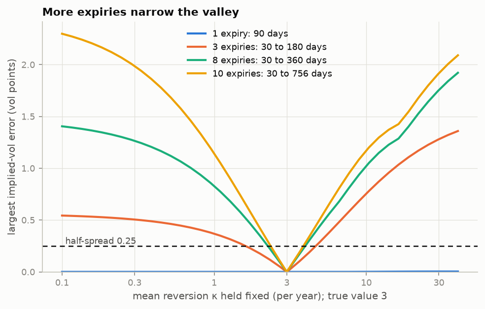
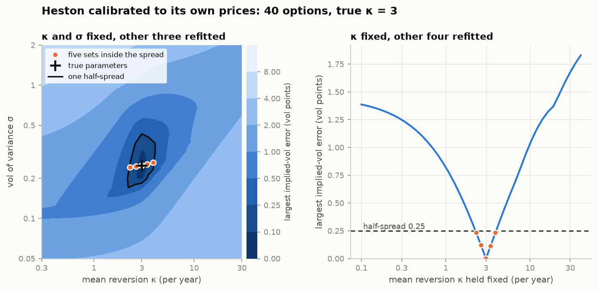
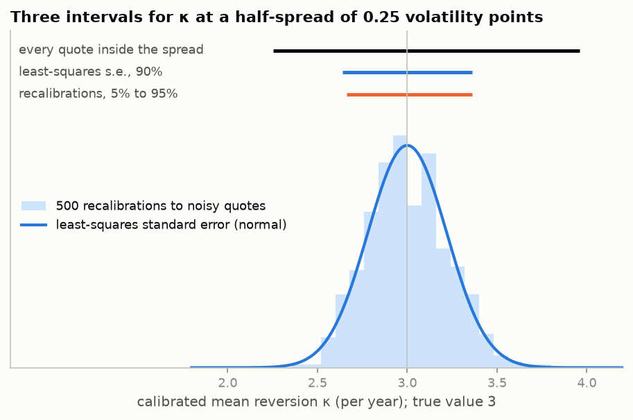
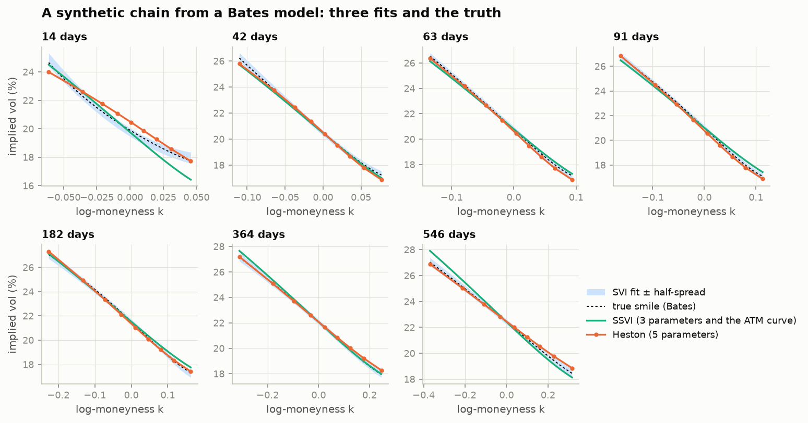
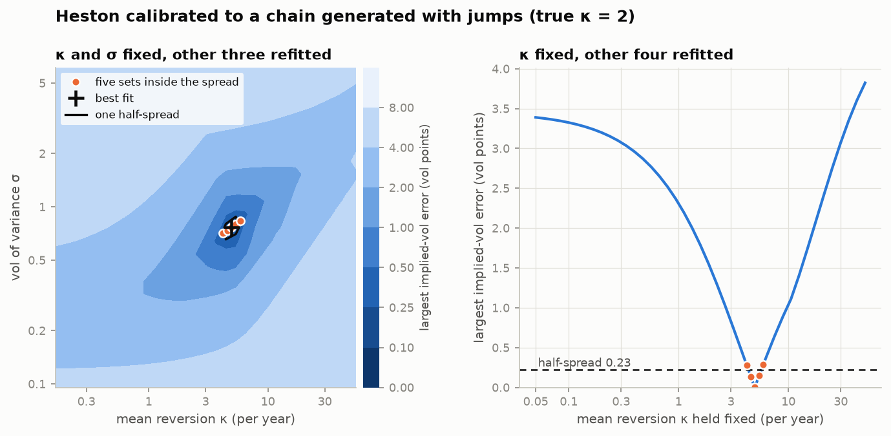

# Meniscus

Fit a volatility surface that cannot be arbitraged, then ask whether calibrating Heston has more than one answer.

## Result

Heston calibration had one answer in every test here. How sharp that answer is depends on how many expiries are in the data and how wide the quotes are.

With one expiry the mean-reversion speed κ is not identified. Any κ from 0.1 to 40 reprices nine options to within 0.004 volatility points of the truth (true κ is 3). With eight expiries and a half bid-ask spread of 0.25 volatility points, κ is pinned to between 2.25 and 3.97. Ten expiries out to three years give 2.35 to 3.86. The valley narrows as expiries are added and it does not close.



That interval is the worst case: every κ in it fits all quotes inside their spread. A calibration to noisy quotes does better, because the noise averages out over the options. Over 500 recalibrations with each quote moved inside its spread, 90% of the fitted κ fell between 2.66 and 3.36. The Fisher information predicts 2.64 to 3.36 without running a single recalibration.

A narrow interval is not a correct one. When the surface comes from a model with jumps, Heston still has one optimum and a tight interval for κ, 4.09 to 6.02. The model that made the surface has κ = 2.

Everything here is on synthetic surfaces. I found no free option-chain data whose terms allow publishing results derived from it, so the study uses models with known parameters and says so. See "Why synthetic data".

## Reproduce

```
uv sync
uv run python scripts/reproduce.py
```

That rebuilds every table and figure in `results/` in about two minutes. It reads no data files and uses no network. All seeds are fixed, so a second run writes the same files. `--fast` uses coarser grids and takes about half a minute. CI runs that.

## Why synthetic data

The design assumed an equity index chain. I could not get one for free under terms I could use:

| Source | What happened |
|---|---|
| CBOE delayed quotes | HTTP 403 from the bot filter for a plain script. Not used. |
| Yahoo Finance options endpoint | Needs a browser session. Not used, and `yfinance` was not used. |
| Nasdaq option-chain API | Reachable. Not used: I did not find terms that allow scripted use. |
| DoltHub `post-no-preference/options` | Reachable. Not used: no licence is stated, and the options are American. |
| Crypto exchange public APIs | Reachable. Not used: the terms I read say results derived from market data need the exchange's approval before they are published. |

So no market data is in this repository, in any form, and no code here downloads any.

Synthetic data has one advantage for this question. The true parameters are known, so "is κ identified" has an answer that can be checked. The cost is that nothing here says how a real chain behaves. The second half of the study narrows that gap: it generates a chain from a richer model than Heston, with a listed strike grid and bid-ask spreads, and treats it the way a real chain would be treated.

## What was built

- Black prices on a forward and implied volatility by bisection
- Raw, natural and jump-wings SVI, and the conversions between them
- A raw SVI fit per expiry, and a refit with penalties for butterfly and calendar arbitrage
- SSVI with the power-law curvature function, fitted so that it is free of static arbitrage by construction
- Butterfly and calendar arbitrage checks from Gatheral and Jacquier
- Heston prices by characteristic function in three forms: the original, the stable one, and the one Cui et al. differentiate
- The analytic gradient of the Heston price in all five parameters, and least-squares calibration with it
- Bates prices (Heston with jumps), used only to generate surfaces
- A synthetic chain: listed-style expiries and strikes, spreads that widen in the wings and at short expiries
- The identifiability study: the Hessian at the optimum, the loss profile along κ, the loss over (κ, σ), parameter sets inside the spread, the Fisher information, a profile-likelihood interval, and recalibration to noisy quotes

## Heston calibrated to its own prices

The surface is the 40-option design of Cui et al.: eight maturities from 30 to 360 days, five strikes each, true parameters v0 = 0.08, v̄ = 0.10, ρ = -0.80, κ = 3, σ = 0.25.

### One optimum

From 100 random starts, all 100 calibrations reached the true parameters. I found no second minimum. A calibration that stops early would report a different κ, which is how Cui et al. explain the "local minima" in earlier work.

### How wide the valley is

For each fixed κ the other four parameters are refitted, and the largest implied-volatility error over the 40 options is recorded.

| Half bid-ask spread (vol points) | κ stays inside the spread from | to |
|---|---|---|
| 0.05 | 2.84 | 3.17 |
| 0.10 | 2.68 | 3.35 |
| 0.25 | 2.25 | 3.96 |
| 0.50 | 1.64 | 5.27 |
| 1.00 | 0.69 | 9.59 |

Across the whole grid, κ from 0.1 to 40, the refitted smile is never more than 1.83 volatility points from the truth.



Five parameter sets inside a 0.25-point spread:

| v0 | v̄ | ρ | κ | σ | Largest vol error (points) |
|---|---|---|---|---|---|
| 0.0804 | 0.1027 | -0.745 | 2.30 | 0.242 | 0.23 |
| 0.0802 | 0.1013 | -0.772 | 2.62 | 0.246 | 0.12 |
| 0.0800 | 0.1000 | -0.799 | 2.99 | 0.250 | 0.00 |
| 0.0798 | 0.0989 | -0.826 | 3.41 | 0.255 | 0.11 |
| 0.0795 | 0.0979 | -0.852 | 3.88 | 0.263 | 0.23 |

The design promised five different sets. These five are different, but not by much: κ moves by a factor of 1.7 and ρ by 0.11.

Along the valley κ, ρ and σ move together. In relative parameter changes the weakest direction of the Hessian is almost all ρ and σ (0.69 and 0.73), and the second weakest is almost all κ (-0.95).

### Three intervals for κ

At a half-spread of 0.25 volatility points, on the same 40 options:

| Method | κ from | to |
|---|---|---|
| Every quote inside its spread (the profile above) | 2.25 | 3.96 |
| Profile likelihood, 90% | 2.65 | 3.37 |
| Fisher information, 90% | 2.64 | 3.36 |
| 500 recalibrations to noisy quotes, 5% to 95% | 2.66 | 3.36 |

The first row asks which κ cannot be ruled out by any single quote. The other three ask how far a least-squares fit moves when each quote is off by a uniform draw inside its spread. They agree with each other. The Fisher standard deviation of κ is 0.220 and the recalibrations give 0.220.



| Parameter | True | Fisher sd | Recalibration sd | Ratio |
|---|---|---|---|---|
| v0 | 0.08 | 0.00039 | 0.00037 | 0.96 |
| v̄ | 0.10 | 0.00078 | 0.00075 | 0.97 |
| ρ | -0.80 | 0.093 | 0.092 | 1.00 |
| κ | 3 | 0.220 | 0.220 | 1.00 |
| σ | 0.25 | 0.031 | 0.029 | 0.95 |

The levels v0 and v̄ are known to better than 1%. ρ and σ are each uncertain by about 12% and are 0.96 correlated, so the data fix a combination of the two much better than either one. In 7.4% of the recalibrations ρ ran to the edge of the search box at -0.999, which the Fisher calculation cannot see. Its 5% point for ρ is -0.95 and the recalibrations give -0.999.

### What you need to pin κ

The Fisher information costs one Jacobian, so it can be worked out for many sets of options. The table gives the largest half-spread, in volatility points, at which a calibration lands within 25% of the true κ nine times in ten. For 10% multiply by 0.4, and for 50% by 2.

| Expiries | 5 strikes each | 9 strikes each | 17 strikes each |
|---|---|---|---|
| 1 (90 days) | none | none | none |
| 2 (30 and 90 days) | 0.12 | 0.13 | 0.17 |
| 3 (30 to 180 days) | 0.25 | 0.29 | 0.37 |
| 5 (30 to 360 days) | 0.46 | 0.54 | 0.69 |
| 8 (30 to 360 days) | 0.52 | 0.60 | 0.77 |
| 10 (30 to 756 days) | 0.72 | 0.84 | 1.08 |

"None" means the answer is below 0.0001 volatility points.

Three things to read off it. A longer span of expiries matters more than a denser one: going from five to eight expiries inside the same year adds about 12%, and adding two expiries out to three years adds 40%. More strikes help less than their number suggests: 17 strikes instead of 5 is 3.4 times the options and allows a spread 1.5 times as wide. And with a typical half-spread of 0.25 points, three expiries are about the least that pins κ to 25%.

The table is a local calculation at the true parameters. Where it says the interval is wide, as in the first two rows, the linear approximation behind it is poor and the profile is the better guide. For the worst-case reading, the profile gives the spread below which every κ more than 25% from the truth misses at least one quote by more than the spread:

| Expiries (9 strikes each) | κ inside 0.25 points | Half-spread that excludes κ off by 25% |
|---|---|---|
| 1 (90 days) | 0.1 to 40, the whole grid | below 0.0001 |
| 3 (30 to 180 days) | 1.61 to 4.65 | 0.10 |
| 8 (30 to 360 days) | 2.25 to 3.97 | 0.20 |
| 10 (30 to 756 days) | 2.35 to 3.86 | 0.22 |

## A chain that Heston did not make

Heston calibrated to Heston prices can always fit exactly. A real surface is not a Heston surface. To get closer to that, the second experiment generates quotes from a Bates model: the diffusion is Heston with v0 = 0.035, v̄ = 0.05, ρ = -0.70, κ = 2, σ = 0.45, and the log price also jumps about once every two years, by -0.10 on average with a standard deviation of 0.12. Jumps carry 20% of the long-run variance. These values were chosen to give an index-like shape, with at-the-money volatility near 20% and a skew that is steepest at short expiries. They were not estimated from any data.

The chain has 11 expiries from 7 to 546 days. Strikes are listed in steps of 1% of the forward near the money and 2.5% or 5% further out, and a strike is quoted only while its out-of-the-money option is worth at least 0.01% of the forward. That leaves 20 quoted strikes at 7 days and 49 at 546 days, 399 quotes in all. The half-spread is 0.2 volatility points at the money for expiries of a month or more, wider at shorter expiries, and grows in the wings up to a cap of 3 points. Each mid sits off the true volatility by a random amount of up to half the half-spread. The quotes are in `results/market/quotes.csv`.



### The surface

| Fit | Quotes inside bid-ask | RMSE to the true smile (vol points) | Static arbitrage |
|---|---|---|---|
| Raw SVI per expiry | 99.5% | 0.17 | none between the quoted strikes; outside them, 2 of 11 slices and 7 of 10 neighbouring pairs |
| SSVI, 3 parameters and the at-the-money curve | 56.1% | not scored | none, by construction |
| SVI refitted with arbitrage penalties | 96.5% | 0.37 | none on log-moneyness from -3 to 3 |

Raw SVI fits the quotes and has no arbitrage where there are quotes. Extrapolated past the quoted strikes, two slices have butterfly arbitrage and seven of the ten neighbouring pairs cross. The refit starts from the SSVI surface, which has no arbitrage, and refits each slice to its own quotes with penalties for a negative density and for crossing either neighbour. It removes all of the arbitrage. The price is paid by the 14 to 63 day slices. At 28 days 79% of the quotes are inside the spread after the refit, against 96% before. Over the whole chain the share drops from 99.5% to 96.5%.

Because the truth is known here, the extrapolation can be scored. At 1.25 times the furthest quoted strike, raw SVI is off by up to 4.3 volatility points and the refit by up to 3.8. Removing arbitrage did not make the extrapolation right.

### Heston on that chain

The target is the SVI fit at nine deltas on each of the ten expiries of 14 days or more, 90 points.

All 20 random starts reached the same parameters. The fit has an RMSE of 0.27 volatility points against a median half-spread of 0.23, and 68% of the points are inside the spread. It misses most at the short end: 0.58 points at 14 days against 0.14 at 364 days.

| | v0 | v̄ | ρ | κ | σ |
|---|---|---|---|---|---|
| Diffusion part of the generator | 0.035 | 0.050 | -0.70 | 2.00 | 0.45 |
| Heston fit | 0.042 | 0.059 | -0.70 | 4.94 | 0.76 |

My reading, which the tables do not prove: Heston has no jumps, so it makes the short-dated skew out of a larger σ, and then needs a larger κ to flatten the skew again at long expiries. The variance levels rise to take in the variance the jumps carried.



The valley is still there and still narrow. κ stays within one half-spread of the best fit from 4.09 to 6.02. Holding κ at the generator's value of 2 raises the RMSE from 0.27 to 0.48 points. Fitting Heston to the true smile with no quote noise gives κ = 4.89, so the shift comes from the missing jumps and not from the noise.

The identifiability tools measure how well the data pin a parameter of the model being fitted. They say nothing about whether that parameter means what its name says.

## What this study cannot show

- How a real chain behaves. The generator, the strike grid and the spread model are all choices made here.
- Whether calibrated parameters are stable through time. There is one surface per experiment and no history.
- Whether the Bates result carries over to other departures from Heston, such as rough volatility. One alternative model was tried.
- Tradable prices. Nothing here is a market quote.

## Sources

- Gatheral and Jacquier, "Arbitrage-free SVI volatility surfaces", Quantitative Finance 14(1), 2014
- Heston, "A Closed-Form Solution for Options with Stochastic Volatility with Applications to Bond and Currency Options", Review of Financial Studies 6(2), 1993
- Albrecher, Mayer, Schoutens and Tistaert, "The Little Heston Trap", Wilmott Magazine, 2007
- Cui, del Baño Rollin and Germano, "Full and fast calibration of the Heston stochastic volatility model", European Journal of Operational Research 263(2), 2017
- Le Floc'h, "An adaptive Filon quadrature for stochastic volatility models", 2016 (reference prices only)
- Bates, "Jumps and Stochastic Volatility: Exchange Rate Processes Implicit in Deutsche Mark Options", Review of Financial Studies 9(1), 1996

Heston (1993) and Bates (1996) were not read. The Heston formula is taken from the restatements in the third and fourth papers. The jump factor is the standard compound-Poisson one and is checked in the tests against a Merton series.

## Comparison with the sources, in brief

- Two published Heston prices are matched to every digit printed (seven and nine).
- The Hessian of Cui et al., Table 8, is matched in kind: the same ill-conditioning (a condition number of 2.7 million here, 4.0 million there), with 13 of 15 entries within 3% to 47%. The other two are off by a factor of ten, and the printed matrix has a negative eigenvalue, so they look like misprints. I could not reproduce their Table 4 exactly, which probably explains the rest.
- Gatheral and Jacquier's arbitrageable smile (Example 3.1) is flagged, and its jump-wings parameters (Example 5.1) are matched to seven digits.
- Two places where I read the paper differently from its text: the jump-wings skew carries a factor of √t, and the power-law SSVI needs γ ≤ 1/2 for the stated guarantee.

Full detail, every formula with its equation number, and the list of variants tried are in `PAPER.md`.

## How it is tested

78 tests, all offline. The maths is tested before any result is trusted.

- Black: put-call parity, the at-the-money closed form, implied volatility round trips, rejection of prices outside the bounds
- Heston: two published reference prices, the Black-Scholes and deterministic-variance limits, agreement of the three characteristic functions at short maturity and the known failure of the original form at 15 years, fixed nodes against adaptive quadrature, the analytic gradient against central differences for four parameter sets
- Bates: the martingale condition, the no-jump limit against Heston, the constant-variance limit against a Merton series, fixed nodes against adaptive quadrature at 7 and 14 days
- SVI: parameter conversions, the published jump-wings values, recovery of its own parameters from generated data
- Arbitrage: the density against a numerical second derivative of call prices, the published arbitrageable smile, three slices broken on purpose, SSVI inside and outside its bound
- Calibration: recovery of the true parameters, the Jacobian, the Hessian against the published table, the profile and the parameter sets inside the spread
- Intervals: the Fisher covariance against the information matrix, the Fisher standard deviations against 40 recalibrations, the likelihood interval against both
- The synthetic chain: the same seed gives the same quotes, the truth is inside every spread, the quoted range widens with expiry
- The whole pipeline run twice writes identical files, and no source file reaches the network

## Layout

```
src/meniscus/      the code
tests/             maths tests first
scripts/reproduce.py   one command rebuilds every figure and table
results/           figures and tables for Heston on its own prices
results/market/    the same for the chain generated with jumps
PAPER.md           citations, formulas, comparison with the sources, variants tried
```

## Roadmap

- [x] Project skeleton, CI, and the reproduce command
- [x] Implied volatility inversion
- [x] Raw and natural SVI fits per expiry, and a full surface
- [x] Butterfly and calendar arbitrage checks
- [x] Heston pricing by characteristic function, in the numerically stable form
- [x] Heston calibration with an analytic gradient
- [x] An identifiability study that maps the loss around the optimum
- [x] `PAPER.md` comparison with the sources
- [x] Results and limits written up at the top of this file

Not done: the interpolation between expiries of Gatheral and Jacquier's Lemma 5.1, a second alternative generator, and anything through time.

## Limits

- Every result is on a synthetic surface.
- The interval for κ depends on the spread you assume, the strikes and the expiries. The tables give several cases; yours will differ.
- The Fisher numbers are local to the true parameters and assume independent noise on each quote. Real quote errors are correlated across strikes.
- The arbitrage checks run on a grid of log-moneyness from -3 to 3. The refit is free of arbitrage on that grid and unchecked beyond it.
- A surface with no static arbitrage can still be wrong. The extrapolation errors above are an example.
- The search box is wide but finite. Some noisy calibrations ended on its edge in ρ.
- This is research code. It is not investment advice and it does not trade.

## The name

A meniscus is the curved surface of a liquid in a glass. Implied volatility bends the same way across strikes.

## Licence

MIT. See `LICENSE`.
